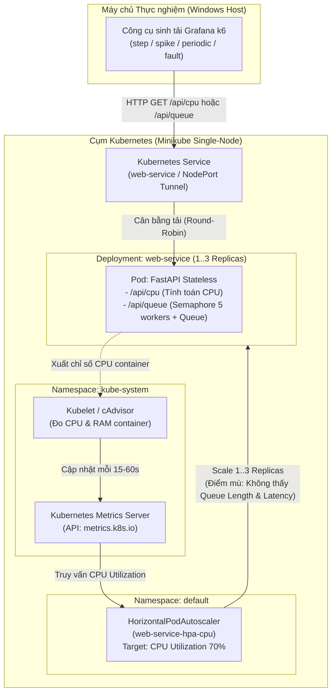
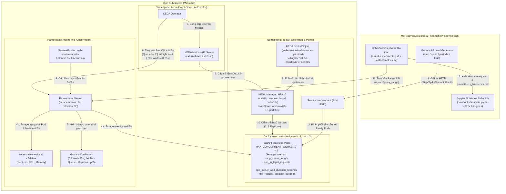
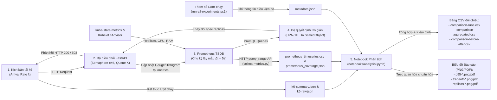
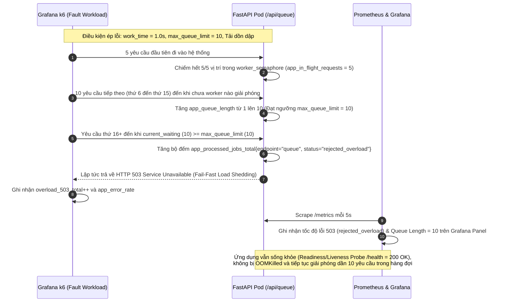

# Sơ đồ Kiến trúc Hệ thống, Luồng Dữ liệu và Trình tự Điều khiển

Tài liệu này cung cấp bộ sơ đồ kiến trúc hiện trạng (Baseline), kiến trúc mục tiêu (Target), sơ đồ luồng dữ liệu (Data Flow) và sơ đồ trình tự (Sequence Diagram) cho cả luồng hoạt động bình thường lẫn tình huống lỗi quá tải hàng đợi của đề tài **Đề tài 3: Tối ưu tự động co giãn cho dịch vụ web theo tải và theo chỉ số nghiệp vụ**.

---

## 1. Sơ đồ Kiến trúc Hiện trạng (Baseline Architecture — HPA theo CPU)

Ở kiến trúc hiện trạng, Kubernetes Horizontal Pod Autoscaler (`web-service-hpa-cpu`) chỉ thu thập chỉ số CPU thông qua `Metrics Server` (`metrics.k8s.io`). Cơ chế này hoạt động hiệu quả với tải thuần tính toán (`/api/cpu`), nhưng **bị mù thông tin (blind spot)** trước các công việc chờ I/O hoặc xếp hàng đợi (`/api/queue`) vì các tác vụ chờ bất đồng bộ (`asyncio.sleep`) tiêu thụ rất ít CPU dù toàn bộ worker đã bão hòa 100%.



---

## 2. Sơ đồ Kiến trúc Mục tiêu (Target Architecture — KEDA Event-Driven & Multi-Metric)

Kiến trúc mục tiêu bổ sung đường thu thập chỉ số nghiệp vụ và chất lượng dịch vụ (QoS) độ phân giải cao (`5s`) qua Prometheus `ServiceMonitor`, kết hợp bộ điều khiển **KEDA (`ScaledObject`)** đánh giá đồng thời 3 tín hiệu (**Độ dài hàng đợi `app_queue_length`**, **Độ bão hòa worker `app_in_flight_requests`**, **Độ trễ chờ p95 `app_queue_wait_duration_seconds`**) và cơ chế **Hysteresis (`behavior.scaleUp` / `behavior.scaleDown`)**.



---

## 3. Sơ đồ Luồng Dữ liệu Thực nghiệm (Data Flow Diagram — End-to-End Pipeline)

Sơ đồ dưới đây mô tả luồng dữ liệu khép kín từ lúc phát sinh yêu cầu HTTP, biến đổi thành chỉ số đo lường, kích hoạt vòng lặp điều khiển co giãn cho tới bước hậu xử lý sinh bảng và biểu đồ học thuật.



---

## 4. Sơ đồ Trình tự (Sequence Diagrams)

### 4.1. Luồng Bình thường & Tự động Co giãn theo Chỉ số Kết hợp (Normal & Proactive Scaling Flow)

Trình tự xử lý khi tải tăng đột ngột (Spike / Periodic) trên `/api/queue` dưới sự điều khiển của chính sách tối ưu `web-service-keda-custom-optimized`:

```mermaid
sequenceDiagram
    autonumber
    participant K6 as Grafana k6 (Load Generator)
    participant SVC as K8s Service (web-service)
    participant Pod1 as FastAPI Pod #1 (5 Workers)
    participant Prom as Prometheus (5s Scrape)
    participant KEDA as KEDA + HPA Controller
    participant K8s as K8s Deployment / ReplicaSet
    participant Pod23 as FastAPI Pods #2 & #3

    Note over K6,Pod1: Giai đoạn 1: Tải nền (Base Rate = 4 req/s, WorkTime = 0.5s -> L = 2 in-flight)
    K6->>SVC: Gửi 4 req/s tới /api/queue
    SVC->>Pod1: Chuyển tiếp yêu cầu
    Pod1->>Pod1: Chiếm 2/5 worker_semaphore (app_in_flight_requests = 2, app_queue_length = 0)
    Pod1-->>K6: HTTP 200 OK (total_response ≈ 0.5s)

    Note over K6,KEDA: Giai đoạn 2: Tải tăng đột biến (Spike = 24 req/s -> L = 12 yêu cầu đồng thời)
    K6->>SVC: Tăng tốc độ gửi lên 24 req/s
    SVC->>Pod1: Dồn yêu cầu vào Pod #1
    Pod1->>Pod1: 5/5 workers bận (in_flight >= 4) & yêu cầu thứ 6+ xếp hàng (queue_length >= 2)
    Prom->>Pod1: Scrape /metrics (chu kỳ 5s)
    Prom-->>KEDA: Trả kết quả PromQL (in_flight=12 > ngưỡng 4; queue_length=7 > ngưỡng 2)
    KEDA->>K8s: Kích hoạt Scale-Up tức thời (stabilizationWindow=0s, +2 Pods/15s -> 3 Replicas)
    K8s->>Pod23: Khởi tạo Pod #2 & Pod #3, kiểm tra Readiness Probe (/health)
    Pod23-->>SVC: Sẵn sàng nhận tải (Ready = True, tổng năng lực = 15 workers = 30 req/s)

    Note over K6,Pod23: Giai đoạn 3: Phân tải ổn định & Giảm tải có Hysteresis
    K6->>SVC: Tiếp tục gửi 24 req/s
    SVC->>Pod1: Phân phối ~8 req/s (queue_length -> 0)
    SVC->>Pod23: Phân phối ~16 req/s (queue_length -> 0)
    Pod1-->>K6: HTTP 200 OK (Độ trễ p95 giảm về ~0.5s)
    Pod23-->>K6: HTTP 200 OK (Độ trễ p95 giảm về ~0.5s)

    Note over K6,K8s: Giai đoạn 4: Tải hạ xuống mức nền (Hysteresis 60s chống dao động Flapping)
    K6->>SVC: Hạ tải về 4 req/s
    KEDA->>KEDA: Giữ nguyên 3 Replicas trong 60s (stabilizationWindowSeconds: 60)<br/>Vượt qua vùng trũng 50s của tải Chu kỳ mà không bị co-giãn liên tục
    KEDA->>K8s: Sau 60s tải thấp liên tục, giảm từ từ (-1 Pod / 30s) về 1 Replica
```

---

### 4.2. Luồng Tình huống Lỗi Quá tải Hàng đợi (Fault Injection / Overload HTTP 503 Flow)

Trình tự xử lý khi tải vượt quá sức chứa hàng đợi (`max_queue_limit = 10`, `work_time = 1.0s` trong kịch bản lỗi `fault-injection.js` / `fault-safe-workload.js`), chứng minh cơ chế **Load Shedding (Fail-fast HTTP 503)** bảo vệ ứng dụng không bị treo hoặc tràn bộ nhớ (`OOMKilled`):



---

## 5. Bảng Phân tích Đánh đổi Thiết kế Kiến trúc (Architectural Trade-offs)

| Quyết định thiết kế | Phương án lựa chọn trong đồ án | Phương án thay thế | Lợi ích đạt được | Chi phí / Giới hạn chấp nhận (Trade-off) |
| :--- | :--- | :--- | :--- | :--- |
| **1. Tín hiệu điều khiển Co giãn** | Kết hợp đa chỉ số nghiệp vụ & QoS trên KEDA (`app_queue_length`, `app_in_flight_requests`, `p95 queue wait`) | Chỉ dùng HPA theo tài nguyên phần cứng (`CPU Utilization 70%`) | Phát hiện chính xác tắc nghẽn hàng đợi & bão hòa worker (80%) ngay cả khi CPU thấp; phản ứng chủ động trước khi độ trễ tăng vọt. | Phụ thuộc vào độ sẵn sàng của chuỗi Prometheus + KEDA Operator; cấu hình phức tạp hơn HPA thuần túy. |
| **2. Chu kỳ lấy mẫu & Polling (`5s` vs `30s`)** | Đồng bộ `5s` trên `ServiceMonitor`, Prometheus global scrape và KEDA `pollingInterval` | Giữ mặc định `30s` của Prometheus và KEDA | Giảm độ trễ phát hiện tải đột biến (Spike 45s) tới 6 lần; cung cấp đủ 6 mẫu trong cửa sổ `rate(...[30s])`. | Tăng nhẹ tải CPU/RAM và dung lượng TSDB của Prometheus (được bù trừ bằng việc giới hạn `retention: 3h`). |
| **3. Cửa sổ ổn định thu hẹp (`scaleDown: 60s`)** | Đặt `stabilizationWindowSeconds: 60`, tốc độ giảm tối đa `1 Pod / 30s` | Dùng mặc định `300s` của K8s HPA hoặc giảm tức thời `0s` | Chặn đứng hiện tượng dao động (flapping) qua vùng trũng `50s` của tải chu kỳ, nhưng vẫn thu hồi Pod nhanh gấp 5 lần so với mặc định `300s` khi hết tải Spike. | Duy trì Pod thêm 60s sau khi tải thực sự kết thúc (tăng nhẹ `ReplicaSeconds` đổi lấy sự ổn định QoS). |
| **4. Cơ chế bảo vệ quá tải (`max_queue_limit` + HTTP 503)** | Kiểm tra giới hạn hàng đợi tại tầng ứng dụng và trả lỗi `HTTP 503` tức thời (Load Shedding) | Để hàng đợi phình vô hạn trong bộ nhớ | Ngăn chặn tràn RAM (`OOMKilled`), giữ `/health` probe luôn phản hồi để Kubernetes không khởi động lại Pod đang xử lý dở công việc. | Xuất hiện tỷ lệ lỗi `503` ngắn hạn trong vài giây đầu khi tải vượt ngưỡng trước khi Pod mới kịp `Ready`. |
| **5. Môi trường triển khai thực nghiệm** | Cụm Minikube cục bộ (Single-node, `maxReplicas: 3`) kết hợp NodePort Service Tunnel | Cụm Kubernetes đa node trên Cloud (GKE / EKS / AKS) | Chi phí \$0, kiểm soát chặt biến nhiễu mạng WAN, dễ dàng tái lập 100% trên máy cá nhân của cả 3 thành viên. | Tổng tài nguyên bị giới hạn bởi máy host (2 CPU, 3 GiB RAM); không đo được độ trễ cấp phát máy ảo mới (Cluster Autoscaler). |
